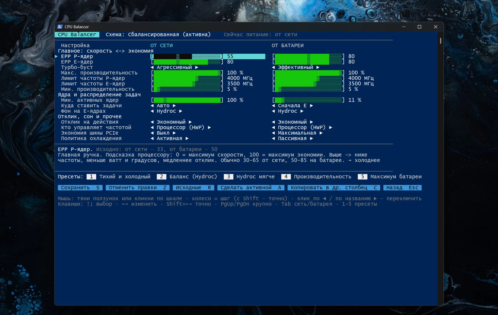

# CPU Balancer

[English](README.md) | **Русский**

Консольное приложение для тонкой настройки схем питания процессора ноутбука под Windows 10/11.
Ползунки, переключатели, пресеты и откат — без установки и без зависимостей, чистый PowerShell.

Сделано под гибридные Intel (Arrow Lake / Lunar Lake / Meteor Lake), работает на любом x86:
настройки, которых нет в системе, просто показываются как «н/д».

## Запуск

1. Скачай архив из [последнего релиза](https://github.com/DonaK200097/cpu-balancer/releases/latest) и распакуй (или скачай `CPU-Balancer.cmd` и `CPU-Balancer.ps1` в одну папку).
2. Дважды кликни `CPU-Balancer.cmd` и подтверди запрос администратора (UAC) — без него Windows не даст менять схемы питания.
3. Выбери схему питания и настраивай.

## Что можно настроить

Каждую настройку — отдельно «от сети» и «от батареи».

| Группа | Настройки |
|---|---|
| Главное | EPP P-ядер и E-ядер (скорость ⟷ экономия), турбо-буст, макс./мин. производительность, лимиты частоты P- и E-ядер |
| Ядра | парковка ядер, распределение задач между P/E-ядрами, удержание фона на E-ядрах (зоны ограничения Windows 11) |
| Прочее | отклик на действия (подсказки задержек), HWP или Windows, экономия PCIe (ASPM), политика охлаждения |

Под каждой настройкой — объяснение простыми словами и подсказка, в какую сторону холоднее.
Маркер `│` на ползунке показывает исходное значение схемы.

## Пресеты

| # | Пресет | Для чего |
|---|---|---|
| 1 | Тихий и холодный | минимум шума и градусов, фон на E-ядрах |
| 2 | Баланс (Hydroc) | EPP 64/80, фон на E-ядрах, без всплесков частоты |
| 3 | Hydroc мягче | то же, но EPP посередине — больше скорости, чуть теплее |
| 4 | Производительность | игры и тяжёлые задачи, быстрый отклик |
| 5 | Максимум батареи | меняет только «от батареи»: буст выкл, EPP 90/95 |

Пресет только подставляет значения — их можно докрутить и сохранить.

## Фоновые программы на E-ядрах

Экран **«Фоновые программы на E-ядрах»** (F) показывает запущенные программы по текущей загрузке CPU. Для каждой можно выбрать режим:

| Режим | Что делает |
|---|---|
| Обычный | как Windows решит сама |
| Эко | EcoQoS — тот же механизм, что «Режим эффективности» в Диспетчере задач: Windows считает программу фоновой, держит её на E-ядрах на низкой частоте и не будит P-ядра. Приоритет снижается до «Ниже среднего» |
| Только E-ядра | Эко + жёсткая привязка к E/LP-E ядрам — максимум холода, но программа работает медленнее |

Подходит для мессенджеров, торрент-клиентов, лаунчеров, синхронизации. Не включай для игр и того, чем пользуешься активно.

Режим действует, пока процесс запущен. **Автоприменение** (W) добавляет задачу в Планировщик заданий: она стартует при входе
в систему, включает режим каждому новому процессу выбранных программ сразу при запуске и перепроверяет раз в 30 с.
Список хранится в `eco-apps.json` рядом с приложением.

## Управление

- **Мышь:** тяни ползунок или кликни по шкале, колесо — шаг (с Shift — точно), клик по `◄` / по названию — переключить, кнопки и пресеты кликабельны.
- **Клавиатура:** ↑↓ выбор, ←→ изменить, Shift+←→ точно, PgUp/PgDn крупно, Tab — сеть/батарея, 1–5 — пресеты,
  S — сохранить, Z — отменить правки, R — исходные значения, A — сделать схему активной, C — копировать в соседний столбец, F — фоновые программы на E-ядрах, Esc — назад.

Правки копятся (помечены `*`) и применяются только по «Сохранить».

## Откат

При первом открытии схемы её исходные значения сохраняются в `backups\<GUID схемы>.json`.
Кнопка «Исходные» (R) возвращает их в любой момент.

## G-Helper / Armoury Crate

Они переключают схемы питания вместе со своими режимами (Silent / Balanced / Turbo),
поэтому удобно настроить каждую схему под свой режим. Лимиты мощности (PL1/PL2) и вентиляторы
по-прежнему задаются в G-Helper / Armoury.
