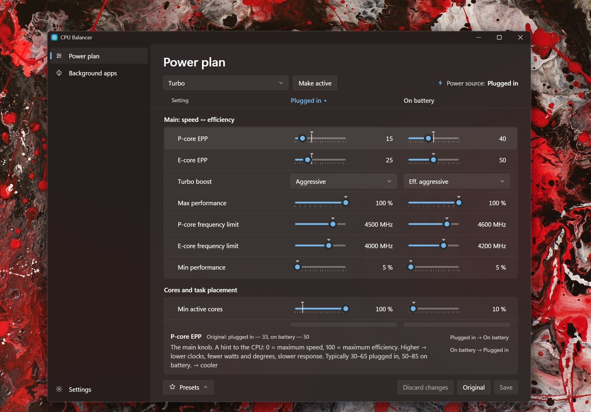

# CPU Balancer

[English](README.md) | **Русский**



Тонкая настройка схем питания процессора ноутбука под Windows 10/11 — один небольшой portable exe
с интерфейсом в стиле Windows 11 (Mica, светлая и тёмная тема, акцентный цвет системы).
Ползунки, пресеты, откат и фоновые программы на E-ядрах — прямо из трея.

Сделано под гибридные Intel (Arrow Lake / Lunar Lake / Meteor Lake), работает на любом x86:
настройки, которых нет в системе, показываются как «н/д». Интерфейс на русском и английском.

## Запуск

1. Скачай `cpu-balancer.exe` из [последнего релиза](https://github.com/DonaK200097/cpu-balancer/releases/latest)
   и положи в любую папку, куда можно писать: данные (бэкапы, настройки) хранятся рядом с ним.
2. Запусти и подтверди запрос администратора (UAC) — без него Windows не даст менять схемы питания и приоритеты программ.
3. Выбери схему питания и настраивай.

Нужен WebView2 (встроен в Windows 11; в Windows 10 обычно ставится вместе с Edge).

## Что можно настроить

Каждую настройку — отдельно «от сети» и «от батареи»; столбец текущего источника питания подсвечен.

| Группа | Настройки |
|---|---|
| Главное | EPP P-ядер и E-ядер (скорость ⟷ экономия), турбо-буст, макс./мин. производительность, лимиты частоты P- и E-ядер |
| Ядра | парковка ядер, распределение задач между P/E-ядрами, удержание фона на E-ядрах (зоны ограничения Windows 11) |
| Прочее | отклик на действия (подсказки задержек), HWP или Windows, экономия PCIe (ASPM), политика охлаждения |

Под выбранной настройкой — объяснение простыми словами и подсказка, в какую сторону холоднее.
Маркер ▼ на ползунке — исходное значение схемы. Клик по числу рядом с ползунком — ввести точное значение с клавиатуры.

Правки копятся и применяются только по **«Сохранить»** (Ctrl+S). **«Отменить правки»** сбрасывает их,
**«Исходные»** подставляет исходные значения схемы.

## Пресеты

| Пресет | Для чего |
|---|---|
| Тихий и холодный | минимум шума и градусов, фон на E-ядрах |
| Баланс (Hydroc) | EPP 64/80, фон на E-ядрах, без всплесков частоты |
| Hydroc мягче | то же, но EPP посередине — больше скорости, чуть теплее |
| Производительность | игры и тяжёлые задачи, быстрый отклик |
| Максимум батареи | меняет только «от батареи»: буст выкл, EPP 90/95 |

Пресет только подставляет значения — их можно докрутить и сохранить. Лимиты частоты пресеты не трогают.

## Фоновые программы на E-ядрах

Вкладка **«Фоновые программы»** показывает запущенные программы по текущей загрузке CPU. Для каждой можно выбрать режим:

| Режим | Что делает |
|---|---|
| Обычный | как Windows решит сама |
| Эко | EcoQoS — тот же механизм, что «Режим эффективности» в Диспетчере задач: Windows считает программу фоновой, держит её на E-ядрах на низкой частоте и не будит P-ядра. Приоритет снижается до «Ниже среднего» |
| Только E-ядра | Эко + жёсткая привязка к E/LP-E ядрам — максимум холода, но программа работает медленнее |

Подходит для мессенджеров, торрент-клиентов, лаунчеров, синхронизации. Не включай для игр и того, чем пользуешься активно.

Режим действует, пока процесс запущен. CPU Balancer в трее включает его каждому новому процессу выбранных программ
сразу при запуске (за доли секунды) и перепроверяет раз в 30 с. Чтобы это работало и после перезагрузки, включи
**«Параметры → Запускать при входе в систему»** (задача Планировщика запускает программу в трее с правами администратора, без запроса UAC).
Список хранится в `eco-apps.json` рядом с программой.

## Трей

Закрытие окна сворачивает программу в трей. Из меню значка можно открыть окно, переключить схему питания,
поставить автоприменение на паузу и выйти. В трее программа почти не нагружает CPU и не будит дискретную видеокарту.

## Откат

При первом открытии схемы её исходные значения сохраняются в `backups\<GUID схемы>.json`.
Кнопка **«Исходные»** возвращает их в любой момент. Бэкапы версии 1 подхватываются автоматически.

## G-Helper / Armoury Crate

Они переключают схемы питания вместе со своими режимами (Silent / Balanced / Turbo),
поэтому удобно настроить каждую схему под свой режим — CPU Balancer сам схемы не переключает.
Лимиты мощности (PL1/PL2), вентиляторы и частоты видеокарты по-прежнему задаются в G-Helper / Armoury.

## Версия 1 (PowerShell)

Исходная консольная версия — без exe, чистый PowerShell — лежит в [`legacy/powershell`](legacy/powershell)
и в [релизе v1.0.0](https://github.com/DonaK200097/cpu-balancer/releases/tag/v1.0.0).

## Сборка из исходников

Rust (stable, MSVC), Node.js LTS, Visual Studio Build Tools (C++), затем:

```
cargo install tauri-cli --version "^2" --locked
cd app && npm install
cd src-tauri && cargo tauri build --no-bundle
```

`cpu-balancer.exe --selftest report.txt` — проверки перед релизом без окна
(значения против `powercfg`, запись и откат, бэкапы v1, эко-режимы, наблюдатель).
